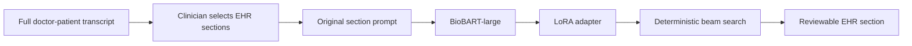

# Medical Dialogue Summary

[](https://github.com/jonleed/Medical-Dialogue-Summary/actions/workflows/ci.yml)
[](LICENSE)
[](https://huggingface.co/jonleed/clinical-note-biobart-large-lora)

A local Flask application that helps clinicians turn a post-visit doctor-patient transcript into copy-ready EHR sections. The clinician pastes the full transcript, selects only the sections needed for that encounter, reviews each generated block, and copies it into the EHR.

This is a continuation of a Deep Learning course project for the University of Surrey. The original BART fine-tuning approach is preserved; the default backbone is now `GanjinZero/biobart-large`, a biomedical BART model released in 2022.

<p align="center">
  
</p>

## Current Application

Run the doctor-facing application:

```bash
python app.py
```

Open <http://127.0.0.1:5002>.

The workflow is deliberately section-based because the MTS-Dialog training data pairs each dialogue with a documented EHR section. It does not force irrelevant sections into every note.

- Paste the complete conversation, not an isolated snippet.
- Select the sections relevant to the encounter.
- Generate each section using the model's original dialogue-to-section task.
- Review the output before copying it into the EHR.
- Routine outputs such as `None.` and `Noncontributory.` are visibly flagged.

The older dataset-table explorer remains available:

```bash
python eval.py
```

Open <http://127.0.0.1:5001>.

## Model

The committed adapter is `biobart-large-lora/`. It contains only the LoRA adapter and tokenizer; the 407M-parameter BioBART-large base downloads from Hugging Face on first use.

- Base model: [`GanjinZero/biobart-large`](https://huggingface.co/GanjinZero/biobart-large)
- Adapter: [`jonleed/clinical-note-biobart-large-lora`](https://huggingface.co/jonleed/clinical-note-biobart-large-lora)
- Fine-tuning method: PEFT LoRA
- LoRA rank: 8
- LoRA alpha: 64
- LoRA dropout: 0.01
- Target modules: BART `q_proj` and `v_proj`
- Input context: 512 tokens
- Output budget: 512 tokens in the Flask app
- Decoding: deterministic beam search, 4 beams, repetition penalty 2.0, no-repeat 4-gram constraint

## Results

Evaluation uses the same prompt and section-target construction as the original notebook. Scores use ROUGE with stemming on 100 validation dialogues, seed 42.

| BioBART-large LoRA evaluation     |   ROUGE-1 |   ROUGE-2 |   ROUGE-L | ROUGE-Lsum |
| --------------------------------- | --------: | --------: | --------: | ---------: |
| 100 validation dialogues, seed 42 | **0.553** | **0.325** | **0.472** |  **0.474** |

The evaluation output is checked in at [`results/eval-biobart-large-2026-08.json`](results/eval-biobart-large-2026-08.json).

### Controlled Model Study

Using the same validation split, seed, prompt construction, token limits, deterministic decoding, and ROUGE scorer:

| Model | ROUGE-1 | ROUGE-2 | ROUGE-L | ROUGE-Lsum |
|---|---:|---:|---:|---:|
| BART-base, no adapter | 0.2195 | 0.0746 | 0.1673 | 0.1671 |
| BART-base with LoRA | 0.4987 | 0.2858 | 0.4342 | 0.4336 |
| BioBART-large with LoRA | **0.5589** | **0.3334** | **0.4803** | **0.4803** |

The complete study record is [`results/model-study-2026-08.json`](results/model-study-2026-08.json). The results show the value of the original LoRA fine-tuning approach and support BioBART-large as the project's selected backbone.

Run the original notebook-style evaluation:

```bash
python eval_notebook_protocol.py --split val
```

Run the Flask integration evaluation through the actual test client:

```bash
python eval_app_integration.py --app note --n 100
python eval_app_integration.py --app section --n 100
```

An earlier BioBART-large Flask integration result reported ROUGE-L 0.4719. The cached integration predictions lack enough model and input provenance for factuality scoring. Flask and notebook output limits also differ; see the [factuality protocol audit](docs/factuality_report.md#coverage-and-protocol-audit).

### Factuality Evaluation Framework: Contradictions, Unsupported Claims, and Omissions

Beyond surface ROUGE overlap, this project includes a targeted evaluation framework to audit **age, gender, and race contradictions, unsupported claims, and clinical omissions** in generated summaries.

#### Framework Design Review

The framework addresses clinical hallucination and confabulation through a two-tiered, frontier-inspired design built for a zero-cost local/free execution budget:

1. **Deterministic Local Demographic Screening (`patient_demographics_v2`)**:
   - **Speaker & Context Grounding**: Distinguishes patient self-statements from physician speech, relative mentions (e.g., parents, siblings, children), and clinical staff.
   - **Explicit Demographic Anchors**: Extracts explicit patient age, biological sex, gender identity, pronouns, and race/ethnicity declarations across dialogue turns.
   - **Address vs. Ground Truth Separation**: Tracks honorifics (e.g., *"sir"*, *"ma'am"*) as weak conversational address cues rather than biological sex or preferred pronouns.
   - **Tri-State Verdicts**: Claims are categorized as `supported` (exact source agreement), `contradicted` (incompatible evidence), or `unclear` (demographic attribute present in summary but unestablished or qualified in dialogue, flagging review candidates).
   - **Input Visibility Tracking**: Audits whether missing facts were visible to the model or cut off by the 512-token context window.

2. **Semantic Claim & Omission Review (Frontier-Inspired Free Pilot)**:
   - Evaluates complex clinical statements (unsupported medication/diagnosis claims and omissions of requested clinical section content) using a pinned free model (`nvidia/nemotron-3-ultra-550b-a55b:free` via OpenRouter).
   - Enforces a strict blinding protocol: requires exact substring evidence spans from both dialogue and summary, rejecting hallucinations, fabricated quotation offsets, and invalid plan IDs without paid fallbacks.

#### Evaluation Results: 300-Summary Demographic Screening

All 300 saved validation summaries across three model configurations (100 per model) were evaluated through the local screening framework:

| Model | Cases | Suggestions | Contradictions | Supported | Unclear | Flagged cases |
|---|---:|---:|---:|---:|---:|---:|
| **BioBART-large with LoRA** | 100 | 58 | **3** | **20** | 35 | 27 |
| **BART-base with LoRA** | 100 | 75 | 4 | 17 | 54 | 38 |
| **BART-base, no adapter** | 100 | 51 | 2 | 49 | 0 | 1 |

*Key Findings:*
- **Contradiction Rate**: BioBART-large with LoRA produced the fewest demographic contradictions (3) while generating the most verified supported claims (20).
- **The "Unclear" Template Confabulation**: In 35 BioBART cases and 54 BART-base LoRA cases, the models generated demographic attributes (e.g., opening sentences such as *"This is a 58-year-old white female..."*) when sex or race was never stated in the conversation. The models inherited this structural preamble from the MTS-Dialog reference training notes, guessing demographic attributes rather than leaving them unstated.
- **Base Model Artifacts**: BART-base without adapter produced 0 unclear suggestions because its collapsed outputs rarely formulated complete patient introduction clauses, but still generated 2 direct age contradictions.
- Full machine-readable aggregate: [`results/factuality/saved-summary-screening-2026-10-18/screening_results.json`](results/factuality/saved-summary-screening-2026-10-18/screening_results.json).

#### Free-Model Development Pilot Results

On the 24 frozen development cases covering targeted error types, the pinned Nemotron 3 Ultra Free reviewer achieved:

| Capability | Planned | Valid reviews | Correct target decisions |
|---|---:|---:|---:|
| Patient age / relative-age controls | 4 | 3 | 2 |
| Sex, gender identity and pronouns | 6 | 6 | 5 |
| Unsupported claims | 3 | 3 | 2 |
| Omissions / section exclusions | 6 | 5 | 5 |
| **Total** | **19** | **17** | **14** |

All 19 requests completed at **\$0.00 actual cost** (12,550 prompt tokens, 2,640 completion tokens). Observed failure modes (including relative age classification and unsupported vs. contradicted confusion) are documented in [`docs/openrouter_factuality_pilot.md`](docs/openrouter_factuality_pilot.md).

#### Reproduce

```bash
# Offline test suite (115 passing tests, no inference)
.venv/bin/python -m unittest discover -s tests -v

# Offline report from saved pilot reviews (no inference)
.venv/bin/python -m factuality.openrouter_pilot report

# Demographic screening of 300 saved summaries (no inference)
.venv/bin/python -m factuality.evaluate_saved_summaries
```

#### Limitations

- Screening suggestions are deterministic rule-based flags, not human-calibrated error rates.
- Unsupported non-demographic clinical claims (medications, diagnoses) and section omissions require LLM review; only the 24-case development pilot assessed these.
- ROUGE scores measure surface n-gram overlap, not clinical accuracy.
- This project is educational and is not a medical device.

## Setup

```bash
git clone --recurse-submodules https://github.com/jonleed/Medical-Dialogue-Summary.git
cd Medical-Dialogue-Summary
python3 -m venv .venv
source .venv/bin/activate
pip install -r requirements.txt
python app.py
```

### Configuration

| Environment variable | Default                    | Purpose                              |
| -------------------- | -------------------------- | ------------------------------------ |
| `BASE_MODEL_ID`      | `GanjinZero/biobart-large` | Base seq2seq model                   |
| `ADAPTER_MODEL_ID`   | `./biobart-large-lora`     | Local or Hugging Face LoRA adapter   |
| `HF_TOKEN`           | unset                      | Optional Hugging Face authentication |

## Reproducing Training

`train_lora.py` mirrors the original notebook while using BioBART-large by default:

```bash
python train_lora.py \
  --base_model GanjinZero/biobart-large \
  --output_dir ./biobart-large-lora \
  --per_device_batch 2 \
  --grad_accum 4 \
  --epochs 20
```

The original notebook recipe is retained in [`Medical_Dialogue_Generation.ipynb`](Medical_Dialogue_Generation.ipynb). Training uses the MTS-Dialog training split, the original prompt and target construction, 512-token inputs, 256-token targets, learning rate `2e-4`, weight decay `0.01`, and per-epoch validation ROUGE. The effective batch size is 8 in the recommended command.

## Architecture



## Project History

The original project used BART-base with LoRA. The restoration preserves that approach and improves the deployable artifact by:

- Loading the base model and adapter separately through PEFT
- Using the biomedical BioBART-large backbone
- Increasing serving input context from 128 to the 512-token training context
- Providing clinician-selected section generation in demo

This project is educational and is not a medical device.

## Future Plans

### Pass EHR Metadata as an Input Context

In real EHR integrations (such as Epic or Cerner), the clinical system already maintains the patient's verified demographic banner (e.g., `Patient: Jane Doe | Age: 58 | Sex: F`). Instead of asking the model to guess demographics from conversational transcripts alone—which frequently leads to ungrounded pronoun hallucination, assumed patient sex/race, or age contradictions—the demographic banner should be prepended directly to the model input context.

Conditioning the summarizer on verified EHR metadata:
- **Eliminates demographic guessing**: Prevents the model from fabricating age, sex, gender, or race attributes when dialogue transcripts omit demographic declarations.
- **Prevents downstream clinical risks**: Protects against erroneous sex-specific lab reference ranges, dosing formula discrepancies, and EHR chart mismatches caused by model confabulation.
- **Focuses summarization capacity**: Allows the seq2seq model to devote its token budget entirely to summarizing clinical complaints, diagnoses, medication changes, and plans discussed during the visit.

## Credits

- Dataset: Ben Abacha et al., [MTS-Dialog](https://github.com/abachaa/MTS-Dialog), EACL 2023
- Biomedical base: [GanjinZero/biobart-large](https://huggingface.co/GanjinZero/biobart-large)
- Frameworks: [PEFT](https://github.com/huggingface/peft), [Transformers](https://github.com/huggingface.co/docs/transformers), Flask

## License

[MIT](LICENSE)
