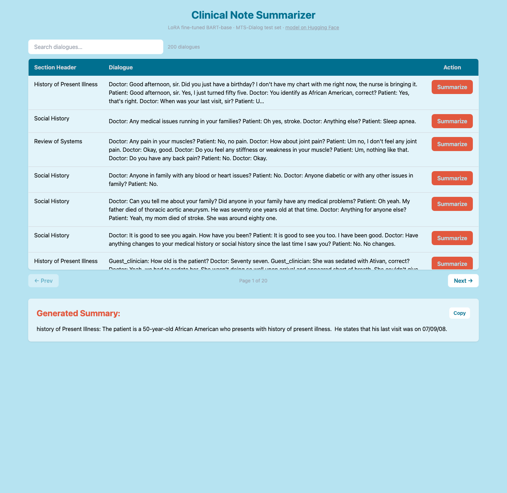
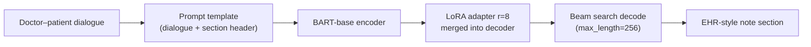

# Medical Dialogue Summary

[](https://github.com/jonleed/Medical-Dialogue-Summary/actions/workflows/ci.yml)
[](LICENSE)

[](https://huggingface.co/jonleed/clinical-note-bart-lora)

Fine-tuned **BART-base with LoRA (PEFT)** that turns doctor–patient dialogues into EHR-style clinical note sections, served through a local Flask demo app. Built May 2025 for a Deep Learning & Advanced AI course project; restored and modernized in August 2026.

<p align="center">
  
</p>

## What it does

1. Loads a dialogue and target section (Chief Complaint, HPI, Medications, …) from the [MTS-Dialog](https://github.com/abachaa/MTS-Dialog) MEDIQA-Chat 2023 test set
2. Wraps them in the training prompt format: *"Summarize the following doctor-patient dialogue into a detailed {section} clinical note: …"*
3. Generates the note with a LoRA adapter (r=8, α=64 on `q_proj`/`v_proj`) merged into `facebook/bart-base`, using beam search (beams=4, max_length=256)

## Results

ROUGE against reference section summaries on the MTS-Dialog test set:

| Source | ROUGE-1 | ROUGE-2 | ROUGE-L | ROUGE-Lsum |
|---|---|---|---|---|
| Reported at project completion (May 2025) | — | — | **0.43** | — |
| Re-evaluation Aug 2026 · 100-example sample · seed 42 | 0.290 | 0.114 | 0.252 | 0.259 |

Both numbers are shown deliberately: the original figure came from an unlogged evaluation setup we can no longer reconstruct exactly, so the 2026 restoration ships a fully reproducible evaluation instead of quietly repeating a number nobody can regenerate:

```bash
python compute_metrics.py --n 100 --seed 42 --out results/eval.json
```

Raw predictions from the re-evaluation are checked in at [`results/eval-2026-08.json`](results/eval-2026-08.json).

## Quickstart

```bash
git clone --recurse-submodules https://github.com/jonleed/Medical-Dialogue-Summary.git
cd Medical-Dialogue-Summary

python3 -m venv .venv && source .venv/bin/activate
pip install -r requirements.txt

python eval.py
# → http://127.0.0.1:5000
```

Browse the dialogue table (search + pagination), hit **Summarize**, get a clinical note. The adapter downloads automatically from Hugging Face Hub on first use.

### Configuration

| Env var | Default | Purpose |
|---|---|---|
| `ADAPTER_MODEL_ID` | `jonleed/clinical-note-bart-lora` | LoRA adapter to load |
| `BASE_MODEL_ID` | `facebook/bart-base` | Base seq2seq model |
| `HF_TOKEN` | unset | Only needed for private/gated repos |

## Training

[`Medical_Dialogue_Generation.ipynb`](Medical_Dialogue_Generation.ipynb) is the original training notebook (run in Google Colab): data prep → tokenization → `LoraConfig(r=8, alpha=64)` via PEFT → `Seq2SeqTrainer` → ROUGE eval → push to Hub. It is kept as-is for historical accuracy; dependencies are installed in its first cell.

Architecture:



## Repository notes & history

This is a continuation of [`Michael-David-Lam/Medical-Dialogue-Summary`](https://github.com/Michael-David-Lam/Medical-Dialogue-Summary), built with course collaborators (branches `dev2tariq`, `dev2jon`, `dev3michael` tell that story). The 2026 restoration fixed what time broke:

- **Runtime**: the Hub artifact only ever contained the 3.5 MB LoRA adapter, but the app tried to load full weights from it — it now loads BART-base and applies the adapter properly through PEFT (`merge_and_unload()`)
- **Data**: replaced a dangling submodule gitlink with a real `MTS-Dialog` submodule pinning upstream
- **Deps**: pinned to tested versions (transformers 5.15 / peft 0.20 / torch 2.13, Python 3.14) after verifying generation behavior was preserved
- **App UX**: lazy model loading, search, pagination over the test set, loading spinner, copy-to-clipboard
- **Reproducibility**: `compute_metrics.py`, CI smoke tests, checked-in predictions

The original prompt format and generation configuration are untouched, so outputs match the May 2025 model's behavior.

**Scope**: educational project demonstrating parameter-efficient fine-tuning of compact seq2seq models for clinical summarization. Not a medical device; outputs are not clinically validated.

## Credits

- Original project: [Michael-David-Lam](https://github.com/Michael-David-Lam) ([original model upload](https://huggingface.co/mdlam/clinical-note-model))
- Dataset: Ben Abacha et al., *"An Empirical Study of Clinical Note Generation from Doctor-Patient Encounters"* (EACL 2023) — [MTS-Dialog](https://github.com/abachaa/MTS-Dialog)
- Frameworks: [PEFT](https://github.com/huggingface/peft), [Transformers](https://github.com/huggingface/transformers)

## License

[MIT](LICENSE)
