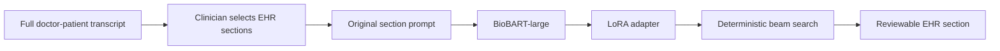

# Medical Dialogue Summary

[](https://github.com/jonleed/Medical-Dialogue-Summary/actions/workflows/ci.yml)
[](LICENSE)
[](https://huggingface.co/jonleed/clinical-note-biobart-large-lora)

A local Flask application that helps clinicians turn a post-visit doctor-patient transcript into copy-ready EHR sections. The clinician pastes the full transcript, selects only the sections needed for that encounter, reviews each generated block, and copies it into the EHR.

This is a continuation of a Deep Learning course project for the University of Surrey. The original BART fine-tuning approach is preserved; the default backbone is now `GanjinZero/biobart-large`, a biomedical BART model released in 2022.

<p align="center">
  
</p>

## Current Application

Run the doctor-facing application:

```bash
python app.py
```

Open <http://127.0.0.1:5002>.

The workflow is deliberately section-based because the MTS-Dialog training data pairs each dialogue with a documented EHR section. It does not force irrelevant sections into every note.

- Paste the complete conversation, not an isolated snippet.
- Select the sections relevant to the encounter.
- Generate each section using the model's original dialogue-to-section task.
- Review the output before copying it into the EHR.
- Routine outputs such as `None.` and `Noncontributory.` are visibly flagged.

The older dataset-table explorer remains available:

```bash
python eval.py
```

Open <http://127.0.0.1:5001>.

## Model

The committed adapter is `biobart-large-lora/`. It contains only the LoRA adapter and tokenizer; the 407M-parameter BioBART-large base downloads from Hugging Face on first use.

- Base model: [`GanjinZero/biobart-large`](https://huggingface.co/GanjinZero/biobart-large)
- Adapter: [`jonleed/clinical-note-biobart-large-lora`](https://huggingface.co/jonleed/clinical-note-biobart-large-lora)
- Fine-tuning method: PEFT LoRA
- LoRA rank: 8
- LoRA alpha: 64
- LoRA dropout: 0.01
- Target modules: BART `q_proj` and `v_proj`
- Input context: 512 tokens
- Output budget: 512 tokens in the Flask app
- Decoding: deterministic beam search, 4 beams, repetition penalty 2.0, no-repeat 4-gram constraint

## Results

Evaluation uses the same prompt and section-target construction as the original notebook. Scores use ROUGE with stemming on 100 validation dialogues, seed 42.

| BioBART-large LoRA evaluation     |   ROUGE-1 |   ROUGE-2 |   ROUGE-L | ROUGE-Lsum |
| --------------------------------- | --------: | --------: | --------: | ---------: |
| 100 validation dialogues, seed 42 | **0.553** | **0.325** | **0.472** |  **0.474** |

The evaluation output is checked in at [`results/eval-biobart-large-2026-08.json`](results/eval-biobart-large-2026-08.json).

### Controlled Model Study

Using the same validation split, seed, prompt construction, token limits, deterministic decoding, and ROUGE scorer:

| Model | ROUGE-1 | ROUGE-2 | ROUGE-L | ROUGE-Lsum |
|---|---:|---:|---:|---:|
| BART-base, no adapter | 0.2195 | 0.0746 | 0.1673 | 0.1671 |
| BART-base with LoRA | 0.4987 | 0.2858 | 0.4342 | 0.4336 |
| BioBART-large with LoRA | **0.5589** | **0.3334** | **0.4803** | **0.4803** |

The complete study record is [`results/model-study-2026-08.json`](results/model-study-2026-08.json). The results show the value of the original LoRA fine-tuning approach and support BioBART-large as the project's selected backbone.

Run the original notebook-style evaluation:

```bash
python eval_notebook_protocol.py --split val
```

Run the Flask integration evaluation through the actual test client:

```bash
python eval_app_integration.py --app note --n 100
python eval_app_integration.py --app section --n 100
```

An earlier BioBART-large Flask integration result reported ROUGE-L 0.4719. The cached integration predictions lack enough model and input provenance for factuality scoring. Flask and notebook output limits also differ, so the two scores aren't comparable.

### Evaluating factuality

The BART models I worked with kept getting patient demographics wrong. They contradicted or invented the patient's age, sex, gender and race. In a clinical note, a wrong age or sex is not a style problem: it can change how a reader interprets everything else. So I built an evaluation framework to measure these errors properly, alongside unsupported claims and omissions, instead of relying on ROUGE, which can't see any of them.

**Key findings**

- **The demographic errors were real, and much more common in BART-base + LoRA.** On 46 randomly sampled dialogues, 28% of BART-base + LoRA summaries (95% CI 15–41%) contained at least one wrong or unsupported patient age, sex or pronoun, against 11% for BioBART-large + LoRA (2–20%).
- **Changing a patient's age exposes it directly.** When the dialogue's age was edited, BioBART-large followed the new age in 9 of 10 cases; BART-base + LoRA followed it in only 3.
- **Race was never invented.** Across all 200 summaries, race only appeared when the dialogue stated it. When I added a race statement to 97 dialogues, both models usually left it out.
- **Omissions are the biggest error overall.** Both models leave out about 30% of the facts a section should contain.

| Summarizer | Patient demographic error | Contradicted claims | Unsupported claims | Expected facts omitted |
|---|---:|---:|---:|---:|
| BioBART-large + LoRA | 11% of summaries | 8% | 4% | 29% |
| BART-base + LoRA | 28% of summaries | 13% | 8% | 31% |

Claim and fact rates are per labelled claim or planned fact, on the same 46 dialogues ([intervals in the report](docs/factuality_v3_report.md#summarizer-error-rates)). Without fine-tuning, BART-base only echoes its prompt, so it has no factuality row.

**How it works**

1. **Write the answer key first.** For each dialogue, I wrote down the facts its requested note section should contain, before seeing any summary. This defines what counts as an omission ([plan guide](docs/factuality_v3_plan_guide.md)).
2. **Label every claim.** I labelled each claim in 100 summaries as supported, contradicted, unsupported or unclear, with the source model hidden.
3. **Run two automatic detectors.** One is a rule checker for patient age, sex, pronouns and race. The other is an LLM judge (Claude Sonnet 5.5), isolated so it never sees the rule checker's answers, my labels or which model wrote the summary.
4. **Score the detectors against my labels.** Headline numbers use 35 held-out dialogues the judge was never tuned on, with confidence intervals from resampling whole dialogues.
5. **Edit dialogues to create rare errors on purpose.** Demographic errors are too rare in real data to measure reliably, so I changed ages, swapped pronouns, and added or removed race statements, then checked whether the summaries followed.

**How well the automatic judge works**

| Error type | Judge precision | Judge recall |
|---|---:|---:|
| Omitted facts (46 held-out) | 0.93 | 0.87 |
| Unsupported claims (16 held-out) | 0.82 | 0.56 |

On the edited dialogues, the judge labelled the summary's demographic claim correctly in 100 of 101 cases. Held-out data has too few real demographic errors to estimate the judge's recall for them.

**What I learned building it**

- **An LLM judge can look accurate for the wrong reason.** In an early pilot, the judge was shown the rule checker's suggestions and simply copied them. Isolating the judge is what made its scores meaningful.
- **Deciding what counts as one claim is half the work.** The first judge rubric bundled facts that I had labelled separately. Spelling out what a single claim is, along with two other rubric fixes, cut the claims the judge failed to match from 45 to 32 on calibration.
- **Rare errors need constructed tests.** Real dialogues contained only 3 race statements, so editing dialogues was the only way to test race handling at all.
- **Writing the answer key before reading outputs matters.** Omission rates depend on it, and it's easy to bias without noticing.

All labels are mine (one non-clinician annotator) on the MTS-Dialog validation split. [Full report](docs/factuality_v3_report.md) · [Design](docs/factuality_v3_design.md) · [Metrics](results/factuality/v3-2026-11-09/metrics.json)

```bash
# Offline tests; no model inference or downloads.
HF_HUB_OFFLINE=1 TRANSFORMERS_OFFLINE=1 .venv/bin/python -m pytest -q tests

# Evaluation stages (need the local artifacts).
.venv/bin/python -m factuality.v3_cli --help
```

## Setup

```bash
git clone --recurse-submodules https://github.com/jonleed/Medical-Dialogue-Summary.git
cd Medical-Dialogue-Summary
python3 -m venv .venv
source .venv/bin/activate
pip install -r requirements.txt
python app.py
```

### Configuration

| Environment variable | Default                    | Purpose                              |
| -------------------- | -------------------------- | ------------------------------------ |
| `BASE_MODEL_ID`      | `GanjinZero/biobart-large` | Base seq2seq model                   |
| `ADAPTER_MODEL_ID`   | `./biobart-large-lora`     | Local or Hugging Face LoRA adapter   |
| `HF_TOKEN`           | unset                      | Optional Hugging Face authentication |

## Reproducing Training

`train_lora.py` mirrors the original notebook while using BioBART-large by default:

```bash
python train_lora.py \
  --base_model GanjinZero/biobart-large \
  --output_dir ./biobart-large-lora \
  --per_device_batch 2 \
  --grad_accum 4 \
  --epochs 20
```

The original notebook recipe is retained in [`Medical_Dialogue_Generation.ipynb`](Medical_Dialogue_Generation.ipynb). Training uses the MTS-Dialog training split, the original prompt and target construction, 512-token inputs, 256-token targets, learning rate `2e-4`, weight decay `0.01`, and per-epoch validation ROUGE. The effective batch size is 8 in the recommended command.

## Architecture



## Project History

The original project used BART-base with LoRA. The restoration preserves that approach and improves the deployable artifact by:

- Loading the base model and adapter separately through PEFT
- Using the biomedical BioBART-large backbone
- Increasing serving input context from 128 to the 512-token training context
- Providing clinician-selected section generation in demo

This project is educational and is not a medical device.

## Future Plans

Evaluate whether supplying verified EHR metadata alongside the transcript reduces demographic contradictions and unsupported demographic assertions. This is a proposed experiment; it has not been implemented or measured. Metadata would need provenance and conflict handling, and its input-token cost should be included in the evaluation.

## Credits

- Dataset: Ben Abacha et al., [MTS-Dialog](https://github.com/abachaa/MTS-Dialog), EACL 2023
- Biomedical base: [GanjinZero/biobart-large](https://huggingface.co/GanjinZero/biobart-large)
- Frameworks: [PEFT](https://github.com/huggingface/peft), [Transformers](https://github.com/huggingface.co/docs/transformers), Flask

## License

[MIT](LICENSE)
