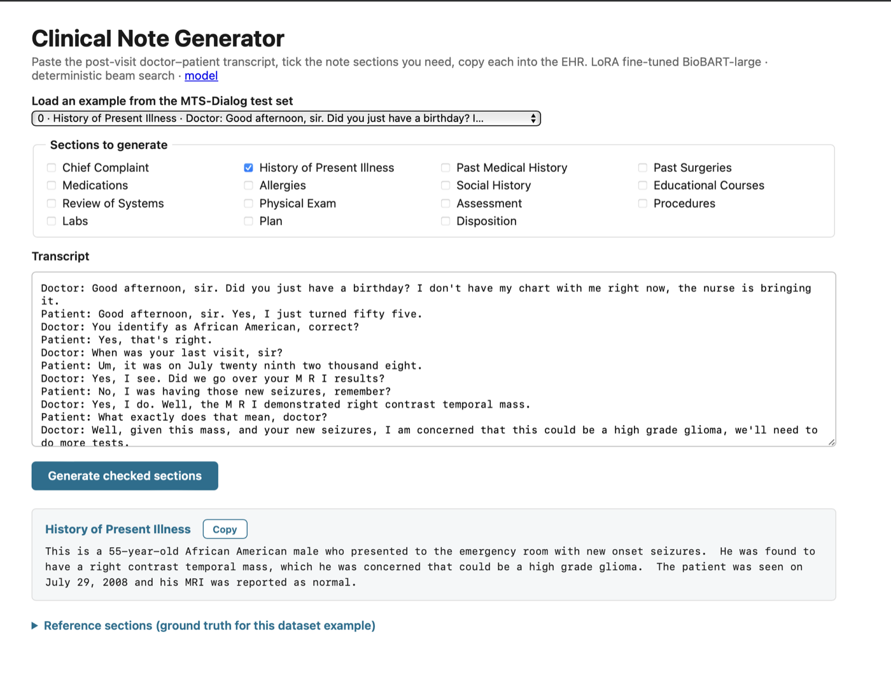
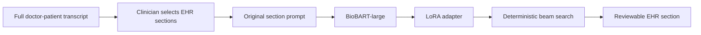

# Medical Dialogue Summary

[](https://github.com/jonleed/Medical-Dialogue-Summary/actions/workflows/ci.yml)
[](LICENSE)
[](https://huggingface.co/jonleed/clinical-note-biobart-large-lora)

A local Flask application that helps clinicians turn a post-visit doctor-patient transcript into copy-ready EHR sections. The clinician pastes the full transcript, selects only the sections needed for that encounter, reviews each generated block, and copies it into the EHR.

This is a continuation of a Deep Learning course project for the University of Surrey. The original BART fine-tuning approach is preserved; the default backbone is now `GanjinZero/biobart-large`, a biomedical BART model released in 2022.

<p align="center">
  
</p>

## Current Application

Run the doctor-facing application:

```bash
python app.py
```

Open <http://127.0.0.1:5002>.

The workflow is deliberately section-based because the MTS-Dialog training data pairs each dialogue with a documented EHR section. It does not force irrelevant sections into every note.

- Paste the complete conversation, not an isolated snippet.
- Select the sections relevant to the encounter.
- Generate each section using the model's original dialogue-to-section task.
- Review the output before copying it into the EHR.
- Routine outputs such as `None.` and `Noncontributory.` are visibly flagged.

The older dataset-table explorer remains available:

```bash
python eval.py
```

Open <http://127.0.0.1:5001>.

## Model

The committed adapter is `biobart-large-lora/`. It contains only the LoRA adapter and tokenizer; the 407M-parameter BioBART-large base downloads from Hugging Face on first use.

- Base model: [`GanjinZero/biobart-large`](https://huggingface.co/GanjinZero/biobart-large)
- Adapter: [`jonleed/clinical-note-biobart-large-lora`](https://huggingface.co/jonleed/clinical-note-biobart-large-lora)
- Fine-tuning method: PEFT LoRA
- LoRA rank: 8
- LoRA alpha: 64
- LoRA dropout: 0.01
- Target modules: BART `q_proj` and `v_proj`
- Input context: 512 tokens
- Output budget: 512 tokens in the Flask app
- Decoding: deterministic beam search, 4 beams, repetition penalty 2.0, no-repeat 4-gram constraint

## Results

Evaluation uses the same prompt and section-target construction as the original notebook. Scores use ROUGE with stemming on 100 validation dialogues, seed 42.

| BioBART-large LoRA evaluation     |   ROUGE-1 |   ROUGE-2 |   ROUGE-L | ROUGE-Lsum |
| --------------------------------- | --------: | --------: | --------: | ---------: |
| 100 validation dialogues, seed 42 | **0.553** | **0.325** | **0.472** |  **0.474** |

The evaluation output is checked in at [`results/eval-biobart-large-2026-08.json`](results/eval-biobart-large-2026-08.json).

### Controlled Model Study

Using the same validation split, seed, prompt construction, token limits, deterministic decoding, and ROUGE scorer:

| Model | ROUGE-1 | ROUGE-2 | ROUGE-L | ROUGE-Lsum |
|---|---:|---:|---:|---:|
| BART-base, no adapter | 0.2195 | 0.0746 | 0.1673 | 0.1671 |
| BART-base with LoRA | 0.4987 | 0.2858 | 0.4342 | 0.4336 |
| BioBART-large with LoRA | **0.5589** | **0.3334** | **0.4803** | **0.4803** |

The complete study record is [`results/model-study-2026-08.json`](results/model-study-2026-08.json). The results show the value of the original LoRA fine-tuning approach and support BioBART-large as the project's selected backbone.

Run the original notebook-style evaluation:

```bash
python eval_notebook_protocol.py --split val
```

Run the Flask integration evaluation through the actual test client:

```bash
python eval_app_integration.py --app note --n 100
python eval_app_integration.py --app section --n 100
```

An earlier BioBART-large Flask integration result reported ROUGE-L 0.4719. The cached integration predictions lack enough model and input provenance for factuality scoring. Flask and notebook output limits also differ, so the two scores aren't comparable.

### Targeted factuality evaluation

A targeted factuality evaluation for **age, gender and race/ethnicity contradictions, unsupported claims and omissions** in the clinical summaries. Two detectors are scored against blinded human labels:

- **Rules:** a deterministic demographic checker that covers race/ethnicity insertion.
- **Judge:** Claude Sonnet 5.5, isolated so it never sees rule output, plans or model identity.

The labels come from source-only expected-fact plans written and frozen before any summary was seen, then claim-level labels on 100 summaries with the models hidden. Headline numbers use 35 held-out dialogues the judge rubric was never tuned on. [Full report](docs/factuality_v3_report.md) · [Metrics](results/factuality/v3-2026-11-09/metrics.json).

**Held-out detector results** (single non-clinician annotator, 35 held-out dialogues; 95% CIs from resampling whole dialogues):

- **Omissions:** the judge detects omissions, precision 0.93 (95% CI 0.81–1.00), recall 0.87 (95% CI 0.72–1.00).
- **Unsupported claims:** the judge screens for unsupported claims, measured recall 0.56 (95% CI 0.32–0.91), precision 0.82.
- **Demographic contradictions:** too few held-out positives to estimate recall.
  - Age: 3, all relatives' ages, all found by the judge.
  - Sex-reference: 4, of which the judge found 3.
  - Race: 0.
  - On calibration, the rules (frozen before any labels) found all 6 patient-age contradictions with no false flags.

**Summarizer error rates** on 46 randomly sampled dialogues:

| Summarizer | Contradicted claims | Unsupported claims | Expected facts omitted |
|---|---:|---:|---:|
| BioBART-large + LoRA | 8% (4–13%) | 4% (1–6%) | 29% (18–39%) |
| BART-base + LoRA | 13% (8–19%) | 8% (4–12%) | 31% (23–40%) |

**No inserted race was found.** This covers all 200 fine-tuned summaries, the held-out labels, and dialogues with their race statement removed. When race was injected into 97 dialogues, the summarizers mostly left it out, and the judge labelled the resulting race claims correctly 75 of 76 times.

**Age edits:** BART-base + LoRA followed only 3 of 10 edited patient ages; BioBART-large followed 9 of 10.

**Validity:** BART-base without an adapter echoes the prompt in all 100 outputs, so it's reported as invalid output, not scored for factuality.

**Limits:** one non-clinician annotator; validation data already used for model selection; the judge rubric was revised once on calibration before freezing; no second judge family. The October 2026 [free-model pilot](docs/openrouter_factuality_pilot.md) is kept as a historical record.

```bash
# Offline tests; no model inference or downloads.
HF_HUB_OFFLINE=1 TRANSFORMERS_OFFLINE=1 .venv/bin/python -m pytest -q

# Pipeline stages (need the local artifacts): validity, screen, cf-build, cf-score, sample,
# plans, freeze-plans, label-packet, import-labels, probe, judge, judge-freeze, score.
.venv/bin/python -m factuality.v3_cli --help
```

Public aggregates are committed. Raw dialogues, summaries, labels and judge responses stay local. [Plan-writing guide](docs/factuality_v3_plan_guide.md) · [Annotation protocol](docs/factuality_protocol.md) · [JSONL schema](docs/factuality_schema.md).

## Setup

```bash
git clone --recurse-submodules https://github.com/jonleed/Medical-Dialogue-Summary.git
cd Medical-Dialogue-Summary
python3 -m venv .venv
source .venv/bin/activate
pip install -r requirements.txt
python app.py
```

### Configuration

| Environment variable | Default                    | Purpose                              |
| -------------------- | -------------------------- | ------------------------------------ |
| `BASE_MODEL_ID`      | `GanjinZero/biobart-large` | Base seq2seq model                   |
| `ADAPTER_MODEL_ID`   | `./biobart-large-lora`     | Local or Hugging Face LoRA adapter   |
| `HF_TOKEN`           | unset                      | Optional Hugging Face authentication |

## Reproducing Training

`train_lora.py` mirrors the original notebook while using BioBART-large by default:

```bash
python train_lora.py \
  --base_model GanjinZero/biobart-large \
  --output_dir ./biobart-large-lora \
  --per_device_batch 2 \
  --grad_accum 4 \
  --epochs 20
```

The original notebook recipe is retained in [`Medical_Dialogue_Generation.ipynb`](Medical_Dialogue_Generation.ipynb). Training uses the MTS-Dialog training split, the original prompt and target construction, 512-token inputs, 256-token targets, learning rate `2e-4`, weight decay `0.01`, and per-epoch validation ROUGE. The effective batch size is 8 in the recommended command.

## Architecture



## Project History

The original project used BART-base with LoRA. The restoration preserves that approach and improves the deployable artifact by:

- Loading the base model and adapter separately through PEFT
- Using the biomedical BioBART-large backbone
- Increasing serving input context from 128 to the 512-token training context
- Providing clinician-selected section generation in demo

This project is educational and is not a medical device.

## Future Plans

Evaluate whether supplying verified EHR metadata alongside the transcript reduces demographic contradictions and unsupported demographic assertions. This is a proposed experiment; it has not been implemented or measured. Metadata would need provenance and conflict handling, and its input-token cost should be included in the evaluation.

## Credits

- Dataset: Ben Abacha et al., [MTS-Dialog](https://github.com/abachaa/MTS-Dialog), EACL 2023
- Biomedical base: [GanjinZero/biobart-large](https://huggingface.co/GanjinZero/biobart-large)
- Frameworks: [PEFT](https://github.com/huggingface/peft), [Transformers](https://github.com/huggingface.co/docs/transformers), Flask

## License

[MIT](LICENSE)
