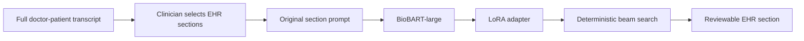

# Medical Dialogue Summary

[](https://github.com/jonleed/Medical-Dialogue-Summary/actions/workflows/ci.yml)
[](LICENSE)
[](https://huggingface.co/jonleed/clinical-note-biobart-large-lora)

A local Flask application that helps clinicians turn a post-visit doctor-patient transcript into copy-ready EHR sections. The clinician pastes the full transcript, selects only the sections needed for that encounter, reviews each generated block, and copies it into the EHR.

This is a continuation of a Deep Learning course project for the University of Surrey. The original BART fine-tuning approach is preserved; the default backbone is now `GanjinZero/biobart-large`, a biomedical BART model released in 2022.

<p align="center">
  
</p>

## Current Application

Run the doctor-facing application:

```bash
python app.py
```

Open <http://127.0.0.1:5002>.

The workflow is deliberately section-based because the MTS-Dialog training data pairs each dialogue with a documented EHR section. It does not force irrelevant sections into every note.

- Paste the complete conversation, not an isolated snippet.
- Select the sections relevant to the encounter.
- Generate each section using the model's original dialogue-to-section task.
- Review the output before copying it into the EHR.
- Routine outputs such as `None.` and `Noncontributory.` are visibly flagged.

The older dataset-table explorer remains available:

```bash
python eval.py
```

Open <http://127.0.0.1:5001>.

## Model

The committed adapter is `biobart-large-lora/`. It contains only the LoRA adapter and tokenizer; the 407M-parameter BioBART-large base downloads from Hugging Face on first use.

- Base model: [`GanjinZero/biobart-large`](https://huggingface.co/GanjinZero/biobart-large)
- Adapter: [`jonleed/clinical-note-biobart-large-lora`](https://huggingface.co/jonleed/clinical-note-biobart-large-lora)
- Fine-tuning method: PEFT LoRA
- LoRA rank: 8
- LoRA alpha: 64
- LoRA dropout: 0.01
- Target modules: BART `q_proj` and `v_proj`
- Input context: 512 tokens
- Output budget: 512 tokens in the Flask app
- Decoding: deterministic beam search, 4 beams, repetition penalty 2.0, no-repeat 4-gram constraint

## Results

Evaluation uses the same prompt and section-target construction as the original notebook. Scores use ROUGE with stemming on 100 validation dialogues, seed 42.

| BioBART-large LoRA evaluation     |   ROUGE-1 |   ROUGE-2 |   ROUGE-L | ROUGE-Lsum |
| --------------------------------- | --------: | --------: | --------: | ---------: |
| 100 validation dialogues, seed 42 | **0.553** | **0.325** | **0.472** |  **0.474** |

The evaluation output is checked in at [`results/eval-biobart-large-2026-08.json`](results/eval-biobart-large-2026-08.json).

### Controlled Model Study

Using the same validation split, seed, prompt construction, token limits, deterministic decoding, and ROUGE scorer:

| Model | ROUGE-1 | ROUGE-2 | ROUGE-L | ROUGE-Lsum |
|---|---:|---:|---:|---:|
| BART-base, no adapter | 0.2195 | 0.0746 | 0.1673 | 0.1671 |
| BART-base with LoRA | 0.4987 | 0.2858 | 0.4342 | 0.4336 |
| BioBART-large with LoRA | **0.5589** | **0.3334** | **0.4803** | **0.4803** |

The complete study record is [`results/model-study-2026-08.json`](results/model-study-2026-08.json). The results show the value of the original LoRA fine-tuning approach and support BioBART-large as the project's selected backbone.

Run the original notebook-style evaluation:

```bash
python eval_notebook_protocol.py --split val
```

Run the Flask integration evaluation through the actual test client:

```bash
python eval_app_integration.py --app note --n 100
python eval_app_integration.py --app section --n 100
```

The BioBART-large adapter produced ROUGE-L 0.4719 through the Flask integration path. This confirms that the served application and evaluation use the same adapter, prompt, input length, and deterministic decode.

## Setup

```bash
git clone --recurse-submodules https://github.com/jonleed/Medical-Dialogue-Summary.git
cd Medical-Dialogue-Summary
python3 -m venv .venv
source .venv/bin/activate
pip install -r requirements.txt
python app.py
```

### Configuration

| Environment variable | Default                    | Purpose                              |
| -------------------- | -------------------------- | ------------------------------------ |
| `BASE_MODEL_ID`      | `GanjinZero/biobart-large` | Base seq2seq model                   |
| `ADAPTER_MODEL_ID`   | `./biobart-large-lora`     | Local or Hugging Face LoRA adapter   |
| `HF_TOKEN`           | unset                      | Optional Hugging Face authentication |

## Reproducing Training

`train_lora.py` mirrors the original notebook while using BioBART-large by default:

```bash
python train_lora.py \
  --base_model GanjinZero/biobart-large \
  --output_dir ./biobart-large-lora \
  --per_device_batch 2 \
  --grad_accum 4 \
  --epochs 20
```

The original notebook recipe is retained in [`Medical_Dialogue_Generation.ipynb`](Medical_Dialogue_Generation.ipynb). Training uses the MTS-Dialog training split, the original prompt and target construction, 512-token inputs, 256-token targets, learning rate `2e-4`, weight decay `0.01`, and per-epoch validation ROUGE. The effective batch size is 8 in the recommended command.

## Architecture



## Project History

The original project used BART-base with LoRA. The restoration preserves that approach and improves the deployable artifact by:

- Loading the base model and adapter separately through PEFT
- Using the biomedical BioBART-large backbone
- Increasing serving input context from 128 to the 512-token training context
- Providing clinician-selected section generation in demo

This project is educational and is not a medical device.

## Credits

- Dataset: Ben Abacha et al., [MTS-Dialog](https://github.com/abachaa/MTS-Dialog), EACL 2023
- Biomedical base: [GanjinZero/biobart-large](https://huggingface.co/GanjinZero/biobart-large)
- Frameworks: [PEFT](https://github.com/huggingface/peft), [Transformers](https://github.com/huggingface.co/docs/transformers), Flask

## License

[MIT](LICENSE)

## Targeted free-model pilot

A [targeted factuality harness](docs/opencode_factuality_pilot.md) adds local fact inventories, exact-evidence semantic review, and section-aware omission checks with a capped OpenCode transport. The selected free DeepSeek reviewer is currently **blocked by OpenCode's HTTP 403 free-tier check**: no valid semantic reviews were produced. The 24-case development packet and offline diagnostics are available; semantic accuracy and clinical validation remain unestablished. No Codex review subprocesses or paid fallback are used by this pilot.

The [OpenRouter follow-up](docs/openrouter_factuality_pilot.md) ran the targeted packet with Nemotron 3 Ultra Free: 19 requests at $0, 17 valid reviews and 14 correct target decisions. Two invalid responses, two extraction gaps and an unsupported/contradicted confusion remain visible. These are development results; independent clinical accuracy is unestablished.
