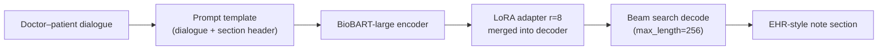

# Medical Dialogue Summary

[](https://github.com/jonleed/Medical-Dialogue-Summary/actions/workflows/ci.yml)
[](LICENSE)

[](https://huggingface.co/jonleed/clinical-note-biobart-large-lora)

Fine-tuned **BioBART-large with LoRA (PEFT)** that turns doctor–patient dialogues into EHR-style clinical note sections, served through a local Flask demo app. Built May 2025 for a Deep Learning & Advanced AI course project; restored and modernized in August 2026.

<p align="center">
  
</p>

## What it does

1. Loads a dialogue and target section (Chief Complaint, HPI, Medications, …) from the [MTS-Dialog](https://github.com/abachaa/MTS-Dialog) MEDIQA-Chat 2023 test set
2. Wraps them in the training prompt format: *"Summarize the following doctor-patient dialogue into a detailed {section} clinical note: …"*
3. Generates the note with a LoRA adapter (r=8, α=64 on `q_proj`/`v_proj`) merged into `GanjinZero/biobart-large`, using beam search (beams=4, max_length=512)

## Results

Two evaluation protocols, both fully reproducible:

**1. Original notebook protocol** (dialogue-to-section generation on the validation split, HF `evaluate` ROUGE with stemmer — the exact setup behind the May 2025 number):

| Source | ROUGE-1 | ROUGE-2 | ROUGE-L | ROUGE-Lsum |
|---|---|---|---|---|
| Reported at project completion (May 2025) | — | — | **0.43** | — |
| Reproduced Aug 2026 · 100 val dialogues · seed 42 | 0.499 | 0.288 | **0.435** | 0.435 |
| BioBART-large adapter · 100 val dialogues · seed 42 | **0.553** | **0.325** | **0.472** | **0.474** |

```bash
python eval_notebook_protocol.py --split val
```

**2. Per-section protocol** (single-section rows from the MEDIQA-Chat test CSV, scored under the original sampling decode):

| Decode | ROUGE-1 | ROUGE-2 | ROUGE-L | ROUGE-Lsum |
|---|---|---|---|---|
| Original sampling config | 0.290 | 0.114 | 0.252 | 0.259 |

```bash
python compute_metrics.py --n 100 --seed 42 --out results/eval.json
```

The original and per-section protocols use the same dialogue-to-section task on different splits and decoding/scoring settings. The original sampling result remains checked in at [`results/eval-2026-08.json`](results/eval-2026-08.json); the BioBART-large app result is [`results/eval-biobart-large-2026-08.json`](results/eval-biobart-large-2026-08.json).

**3. App integration eval** — scores responses served through Flask's test client with the identical protocol as the corresponding harness, proving the demos measure the same thing as the evals (served predictions are byte-identical to direct model calls):

```bash
python eval_app_integration.py --app note --n 100          # whole-transcript demo vs notebook-protocol numbers
python eval_app_integration.py --app section --n 100       # per-section demo vs results/eval-2026-08.json
```

## Quickstart

```bash
git clone --recurse-submodules https://github.com/jonleed/Medical-Dialogue-Summary.git
cd Medical-Dialogue-Summary

python3 -m venv .venv && source .venv/bin/activate
pip install -r requirements.txt

python app.py    # whole-transcript demo → http://127.0.0.1:5002 (recommended)
```

**Whole-transcript demo** (`app.py`): paste the post-visit doctor–patient transcript, tick the EHR sections you need, and each is generated with its own in-distribution request (~2s per section) into a separate copy-ready block; routine/negative results (`Noncontributory.`, `None.`, …) are flagged automatically. The original BART-base adapter remains available through `ADAPTER_MODEL_ID` and `BASE_MODEL_ID` overrides.

The BioBART-large adapter improves the same protocol to ROUGE-L **0.472** (ROUGE-1 0.553, ROUGE-2 0.325, ROUGE-Lsum 0.474) on 100 validation dialogues. The committed adapter is used locally by default; the model is also available at [`jonleed/clinical-note-biobart-large-lora`](https://huggingface.co/jonleed/clinical-note-biobart-large-lora).

```bash
python eval.py   # legacy per-section explorer → http://127.0.0.1:5001
```

> macOS note: AirPlay Receiver occupies port 5000 by default, so the apps use 5001/5002. Override with `PORT=<port>`.

### Configuration

| Env var | Default | Purpose |
|---|---|---|
| `ADAPTER_MODEL_ID` | `./biobart-large-lora` | LoRA adapter to load |
| `BASE_MODEL_ID` | `GanjinZero/biobart-large` | Base seq2seq model |
| `HF_TOKEN` | unset | Only needed for private/gated repos |

## Training

[`Medical_Dialogue_Generation.ipynb`](Medical_Dialogue_Generation.ipynb) is the original training notebook (run in Google Colab): data prep → tokenization → `LoraConfig(r=8, alpha=64)` via PEFT → `Seq2SeqTrainer` → ROUGE eval → push to Hub. It is kept as-is for historical accuracy; dependencies are installed in its first cell.

Architecture:



## Repository notes & history

This is a continuation of [`Michael-David-Lam/Medical-Dialogue-Summary`](https://github.com/Michael-David-Lam/Medical-Dialogue-Summary), built with course collaborators (branches `dev2tariq`, `dev2jon`, `dev3michael` tell that story). The 2026 restoration fixed what time broke:

- **Runtime**: the Hub artifact only ever contained the LoRA adapter, but the app tried to load full weights from it — it now loads the selected BioBART/BART base and applies the adapter properly through PEFT (`merge_and_unload()`)
- **Data**: replaced a dangling submodule gitlink with a real `MTS-Dialog` submodule pinning upstream
- **Deps**: pinned to tested versions (transformers 5.15 / peft 0.20 / torch 2.13, Python 3.14) after verifying generation behavior was preserved
- **App UX**: lazy model loading, search, pagination over the test set, loading spinner, copy-to-clipboard
- **Reproducibility**: `compute_metrics.py`, CI smoke tests, checked-in predictions
- **App/eval parity**: deterministic beam-search decoding in the demo, loud failure instead of silent adapter fallback, `eval_app_integration.py` scoring served outputs end-to-end

The original prompt format and model weights are untouched. Decoding switched from sampling to deterministic beam search (beams=4) to match how the evaluations generate — served outputs are now reproducible byte-for-byte.

**Scope**: educational project demonstrating parameter-efficient fine-tuning of compact seq2seq models for clinical summarization. Not a medical device; outputs are not clinically validated.

## Credits

- Original project: [Michael-David-Lam](https://github.com/Michael-David-Lam) ([original model upload](https://huggingface.co/mdlam/clinical-note-model))
- Dataset: Ben Abacha et al., *"An Empirical Study of Clinical Note Generation from Doctor-Patient Encounters"* (EACL 2023) — [MTS-Dialog](https://github.com/abachaa/MTS-Dialog)
- Frameworks: [PEFT](https://github.com/huggingface/peft), [Transformers](https://github.com/huggingface/transformers)

## License

[MIT](LICENSE)
