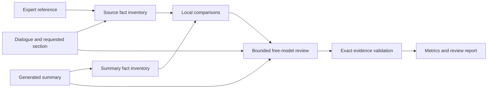

# Targeted clinical factuality evaluation — design for review

Date: October 18, 2026. Status: proposed design; implementation and inference paused for review.

## Outcome and scope

Build an inspectable evaluation that supports this project description:

> Built a targeted factuality evaluation for age and gender contradictions, unsupported claims, and omissions in clinical summaries.

The deliverable is a working evaluator, evidence-backed examples, reproducible tests, and measured limitations. It does not establish comprehensive medical accuracy or clinical safety. The user permits LLM assistance through OpenCode's free models and wants to protect their Codex allowance.

The current stage authorizes preparing the implementation and a maximum 48-attempt pilot after the Superpowers review gates. A production review of 300 saved summaries is a later stage; it must not start automatically after the pilot.

## Approaches considered

| Approach | Strength | Limitation |
|---|---|---|
| Local extraction and rules alone | Cheap, deterministic, easy to inspect | Misses unfamiliar phrasing and semantic support/omission relationships |
| Two LLMs review every summary | Broad semantic coverage and a comparison between providers | More requests; agreement still does not establish correctness |
| Local facts and rules, bounded LLM comparison | Transparent comparisons with semantic help where needed | Requires measuring extraction misses and keeping ambiguous items unresolved |

Use the third approach. During the pilot both free models independently receive the same cases. Model selection is provisional and based on known targets, not agreement between the models.

## Architecture

The LLM receives the full dialogue as well as extracted facts so it can identify extractor mistakes. A fact absent from the extracted table is not proof that it is absent from the dialogue. Oversized inputs remain unassessed instead of being silently truncated.

Reuse the existing `factuality/` evidence schema, demographic checks, scoring conventions, saved predictions, and synthetic challenge. Add a separate OpenCode transport and pilot entry point. Do not call the historical Codex transport, change serving/training, regenerate the 300 summaries, or rewrite old result files.

### Fact representation and local checks

Represent a fact with its subject (patient, relative, clinician, or unresolved), type, normalized value/unit, negation, certainty, temporal context, exact text span, and extraction provenance. Missing attributes stay unknown. Extraction does not certify that the inventory is exhaustive.

Reuse the existing age, pronoun, sex, and gender extractors. Extend their common representation for explicit quantities, medication mentions, and negation where reliable. Unhandled clinical phrasing is available to the semantic reviewer and contributes to measured extraction gaps.

Compare current patient age separately from durations, gestational age, and relatives' ages. Compare sex, gender identity, and patient pronouns as separate dimensions. Names, occupations, diagnoses, and honorifics do not establish gender. Conflicting source evidence remains unclear.

### Claim judgments

Each atomic generated claim receives `supported`, `contradicted`, `unsupported`, or `unclear` with a short rationale. A contradiction requires incompatible source evidence. An unsupported claim requires review of the available dialogue, not merely failure to retrieve a matching fact.

Keep deterministic suggestions and each model's judgments as separate records. A disagreement remains visible; neither rules nor model consensus automatically becomes gold. Require exact generated spans and exact source quotations for supported/contradicted judgments. Repeated quotations preserve attribution ambiguity rather than selecting an arbitrary speaker. Invalid evidence is a failed review, not a passing claim.

### Omission judgments

Prepare and freeze the expected-fact inventory from the dialogue, requested section, and reference before generated-summary assessment. Only source-supported, section-relevant facts may be required. Model-proposed requiredness is recorded as a proposal, not expert certification.

Classify expected facts as `present`, `omitted`, `excluded`, or `unclear`. Optional/out-of-section content is excluded. A fact present through a paraphrase is present. Reference content not established by the dialogue cannot automatically create an omission. Report omission rates conditional on the stated inventory and its provenance.

Synthetic omission targets are predefined by controlled construction. They are synthetic gold, not blinded physician annotations.

## OpenCode execution and usage boundary

Allow exactly these provider-qualified IDs:

- `opencode/deepseek-v4.1-flash-free`
- `opencode/glm-5.3-flash-free`

Both were listed by the installed `opencode2` CLI during read-only discovery. Its installed version is `v0.0.0-beta-18743`; stable `opencode v2.0.32` is also installed. Start with the user-requested `opencode2`. An incompatible preview is a reported preflight failure, not permission to silently substitute another executable or model.

Use OpenCode's supported client, without extracting credentials or bypassing free-tier restrictions. The adapter must verify model routing and effective configuration before running the pilot. Disable tools, MCP, delegation, title-generation inference, warming, compaction, and provider/model fallback. Run in a fresh isolated context for each case. If the installed client cannot enforce the required configuration, stop before a batch.

| Pilot control | Limit / behavior |
|---|---|
| Inference attempts | 48 total, including failed attempts; 24 cases per model |
| Concurrent requests | 1 |
| Automatic retries | 0 |
| Main response output | At most 2,000 provider tokens per attempt, if the client can enforce it |
| Total actual input tokens | At most 250,000, including reported client overhead |
| Total actual output tokens | At most 96,000 |
| Per-attempt deadline | 120 seconds; terminate the owned process tree on timeout/cancellation |
| Charging/fallback | Free IDs only; no paid models or Codex subprocesses |
| Quota/authentication errors | Stop the batch and preserve completed results |
| After the pilot | Stop and report; no automatic production run |

Reserve input/output allowance conservatively before dispatch. After the first authorized case, inspect actual provider/model IDs, token usage, and auxiliary-response events before dispatching another. If hidden overhead cannot be bounded or usage cannot be audited, stop and report that limitation. Any diagnostic inference consumes the same 48-attempt allowance; there are no extra smoke-test calls outside it. Missing reviews retain their denominators in coverage/end-to-end metrics.

Free model availability is temporary. Recheck official availability and the local catalog without inference before a run. Rate-limit waits do not trigger indefinite background retries. No automation is created.

## Pilot and validation

Freeze 24 controlled cases, their evidence, expected facts, and targets before either model runs. Use four groups of six, each containing three errors and three controls:

1. Patient-age contradictions, with controls for family ages, number words, and temporal ambiguity.
2. Gender/sex/pronoun contradictions, with controls for weak cues and wrong-person attribution.
3. Unsupported assertions, with supported paraphrase controls and dialogue-wide evidence checks.
4. Essential omissions, with present, optional, or out-of-section controls.

Use the existing synthetic challenge where suitable and add the omission constructions it lacks. This pilot is a small development comparison, not an independently curated clinical holdout. Do not expose gold labels, target spans, source model identity, or the other reviewer's answers to either model.

Report, separately for each capability and model:

- Precision, recall, false-positive counts, and explicit denominators.
- Target extraction coverage and end-to-end target correctness; missed extraction remains a miss.
- Valid response coverage, unclear/failed/unassessed items, disagreements, token usage, and elapsed time.

Rank provisionally by the mean of the four capability F1 scores, with missed/invalid positive targets counted as false negatives. Break ties by fewer false positives, then higher valid coverage, then fewer reported tokens, then stable model-ID order. Do not tune prompts and rerun these same cases as if they were unseen. The pilot can also conclude that neither model is adequate for production.

### Existing expert data and later testing

MTS-Dialog's published manual scores cover 400 outputs from other systems on the familiar validation dialogues. They can test aggregate evaluator agreement, with source-grouped analysis and compatible scoring definitions. They are not atomic labels for our 300 saved outputs. MedVAL physician assessments can supplement external error/omission analysis; its risk grades do not directly validate these four targeted endpoints.

Keep MTS Test Set 2 reserved for a later final summarizer evaluation, filtering the normalized training overlap found in the local split audit and checking historical use. Do not spend the 48-call pilot budget on a second large benchmark. Any subsequent expert-score study or production run needs its own reviewed request budget.

## Deliverables and completion criteria

1. A separate OpenCode adapter and local fact-comparison path with no Codex fallback.
2. A frozen 24-case pilot manifest, versioned prompts, immutable requests/results, exact spans, and model/configuration hashes.
3. Offline regression tests for model allowlisting, budget exhaustion/resume, cancellation, invalid evidence, cross-patient attribution, extraction misses, and section-aware omissions.
4. A pilot report with actual coverage, errors, examples, and usage; failures are preserved and never counted as passes.
5. Updated project documentation describing the implemented targeted evaluator and its measured limits. Do not claim full clinical validation, expert-equivalent accuracy, or completed review of all 300 summaries.

The evaluator may support the stated project description once its four paths work and are demonstrated. Quantitative performance claims require the corresponding measured results and qualifications.

## Superpowers review sequence

- [x] Reflect the user's goal and cost constraint; inspect the current evaluator and installed CLI without inference.
- [x] Compare approaches and write this design, including scope, budget, failure behavior, and success criteria.
- [x] Self-review for conflicting budgets, ambiguous provenance, incomplete labels, and scope expansion.
- [ ] User reviews this written design.
- [ ] Use `superpowers:writing-plans` to produce a task-by-task implementation plan grounded in this design.
- [ ] User reviews that plan and selects execution method. Recommend inline execution without Codex subagents to protect usage.
- [ ] Implement with offline tests, verify transport controls, run only the capped pilot, and report.

## References

- [OpenCode model availability, pricing, and free-tier terms](https://opencode.ai/v2/docs/console/models/)
- [OpenCode v2 configuration](https://opencode.ai/v2/docs/config/)
- [MTS-Dialog release and manual correlation scores](https://github.com/abachaa/MTS-Dialog)
- [Project dataset audit](../../dataset_selection_2026-10-18.md)
- [Earlier stopped semantic-study design and limitations](../../semantic_study_2026-10-18_plan.md)
